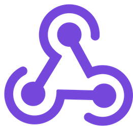

[v1.15.0](https://registry.terraform.io/providers/neilmartin83/axm/latest/docs) is out, and introduces webhook management for Apple Business.

Apple introduced support for webhooks to the Apple Business API in [release 2.8](https://developer.apple.com/documentation/apple-school-and-business-manager-api/apple-school-manager-and-apple-business-api-changelog?ref=macadmins.news#28-Apple-Business-20261104).

> Webhooks notify your systems when something changes in your organization so you don’t have to poll the API. When a subscribed event occurs, Apple sends an HTTPS POST with a JSON payload to the URL you specify

Read [this guide](https://developer.apple.com/documentation/apple-school-and-business-manager-api/understanding-apple-business-api-webhook-events) for more information about managing webhooks in Apple Business. At the time of writing, it looks like it's only possible to manage webhooks using the API, with no visibility of them in the UI at all, as far as I can tell.

## [axm_webhook](https://registry.terraform.io/providers/neilmartin83/axm/latest/docs/resources/webhook)

The new `axm_webhook` resource lets you manage the webhook name, URL, subscribed event types, and enabled state in Terraform. Here's a simple example that will fire whenever an attribute on an organisation device changes:

```hcl
variable "webhook_secret" {
  type      = string
  sensitive = true
}

resource "axm_webhook" "device_changes" {
  name        = "Device change notifications"
  enabled     = true
  event_types = ["ORG_DEVICE_ATTRIBUTE_CHANGED"]
  secret_wo   = var.webhook_secret
  url         = "https://example.com/webhooks/apple"

  secret_wo_version = 1
}
```

`event_types` accepts `ORG_DEVICE_ATTRIBUTE_CHANGED`, `ORG_DEVICE_ATTRIBUTE_MIGRATION_DETAILS_CHANGED`, `ORG_DEVICE_RELATIONSHIP_ASSIGNED_SERVER_CHANGED` and `ORG_DEVICE_RELATIONSHIP_WARRANTY_CHANGED`. The URL needs to be HTTPS, and `enabled` defaults to `true`.

`secret_wo` is a write-only argument, so the shared secret Apple uses to sign notifications is never stored in Terraform state. Write-only arguments require Terraform 1.11 or later. When you need to rotate the secret, update its value and increment `secret_wo_version` to trigger the resource update.

This release also adds a couple of under-the-bonnet performance optimisations, including support for Go's [new jsonv2](https://go.dev/blog/jsonv2) package and batching fetches for multiple device records by serial number into a single request using newly added [filtering support](https://developer.apple.com/documentation/apple-school-and-business-manager-api/apple-school-manager-and-apple-business-api-changelog?ref=macadmins.news#27-Apple-Business-20261029) from Apple. The latter will help keep API requests to a minimum for validation operations when assigning or unassigning devices to a Device Management Service.

## Ensure you're on the latest version

```hcl
terraform {
  required_providers {
    axm = {
      source  = "neilmartin83/axm"
      version = "~> 1.15.0"
    }
  }
}
```

Full docs are on the [Terraform Registry](https://registry.terraform.io/providers/neilmartin83/axm/latest/docs) and source is on [GitHub](https://github.com/neilmartin83/terraform-provider-axm). As always, feedback, berating, issues and PRs are very welcome!
